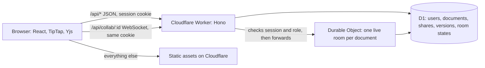

# Architecture note

## What I prioritised, in order

1. **A deployed app from minute ten.** A health route that reads the database went live before any feature. Every later step was deployed and checked on the live URL.
2. **Access rules that hold on the server.** Sharing is the part of a document tool that goes wrong quietly. One module decides who can do what, and a test asserts every cell of the access table.
3. **An editor that does not lose work.** Changes save on their own with a visible state, and earlier versions can be restored.
4. **File import that keeps structure.** .docx, .md and .txt become normal editable documents with headings, lists and inline formatting intact.
5. **Real-time editing, last and behind a fallback.** Several people can type in one document and see each other's cursors. I built it only after the first four were live and tagged (`v1-submittable`), on a branch, and proved it on a separate staging copy before it replaced the live site.

Version history and real-time editing are the stretch items. View and edit roles were part of the sharing design from the start. Markdown export came almost free with the Markdown importer.

## Shape

- **Client** (`src/`): a React single-page app. TipTap is the editor. TanStack Query holds server state. Controls (toolbar, dialogs, menus, selects) are ui-sdk components, which bring keyboard and screen-reader behaviour, themed in `src/index.css`. `src/api.ts` is the only file that calls the API, and `src/hooks/useCollab.ts` is the only file that opens a socket.
- **API** (`worker/`): a Hono app on a Cloudflare Worker. Routes parse the body with zod, call the access module, then read or write through Drizzle.
- **Live rooms** (`worker/room.ts`): a Durable Object per document. It holds the shared Yjs document while anyone has it open, relays edits and cursors, and is the only writer of a document's title and content.
- **Database**: Cloudflare D1 (SQLite). Migrations in `migrations/` are plain SQL generated from `worker/db/schema.ts`. Local development and the tests use the D1 and Durable Object emulators that ship with wrangler, so nobody needs a Cloudflare account to run the project.
- **Deploy**: `npm run deploy` builds the client and uploads the client, the Worker and its config in one step. Cloudflare serves the static files itself, and only `/api/*` runs the Worker.

## Data model

| Table | Columns | Notes |
|---|---|---|
| `users` | id, email (unique), name, password_hash, created_at | Three seeded accounts |
| `documents` | id, owner_id, title, content, version, created_at, updated_at, updated_by | `content` is TipTap JSON stored as text. `version` goes up by one on every save |
| `document_shares` | document_id, user_id, role, created_at | Primary key on both ids. `role` is `viewer` or `editor` |
| `document_versions` | id, document_id, title, content, saved_by, saved_at | Earlier states of a document. At most 50 per document |
| `document_states` | document_id, version, state | The Yjs state behind a live room, and the document version it belongs to |

The owner is a column on the document, not a row in the shares table, so a document can never end up without an owner.

Content is stored as the editor's JSON, not HTML. It round-trips without loss, it can be validated node by node, and nothing in the app ever injects stored HTML into the page. The JSON stays the readable copy that the list, history, export and API use. The Yjs state next to it exists so a room can pick up exactly where it left off.

## Access rules

`worker/access.ts` is the only place that decides access. Every document route calls `requireAccess(db, documentId, userId, action)` before it does anything, and so does the route that opens a live socket.

| Action | Owner | Editor | Viewer | No access | Signed out |
|---|---|---|---|---|---|
| Read the document | 200 | 200 | 200 | 404 | 401 |
| Open it for live editing | 101 | 101 | 101 | 404 | 401 |
| Edits sent over the socket | applied | applied | dropped | no socket | no socket |
| See who has access | 200 | 200 | 200 | 404 | 401 |
| See the version history, read an old version | 200 | 200 | 200 | 404 | 401 |
| Restore an old version | 200 | 200 | 403 | 404 | 401 |
| Share, change a role, remove a share | 200 | 403 | 403 | 404 | 401 |
| Delete | 204 | 403 | 403 | 404 | 401 |

A user with no access gets 404, not 403, so the API never confirms that a document id exists. The page hides controls a role cannot use, but that is only for comfort. The server refuses either way, and `test/worker/access.spec.ts` asserts every cell of this table against the real Worker, a real D1 database and real sockets.

## Real-time editing

Each document has one live room, a Durable Object that holds a Yjs document. Yjs is a CRDT: every client applies its own edits at once and sends them on, and any two clients that have seen the same edits end up with the same text, whatever order the edits arrived in. So there is no "someone saved first" conflict to resolve, and two people can type in the same paragraph.

How a session runs:

1. The browser opens a WebSocket to `/api/collab/:id`. The Worker checks the session cookie, the request's Origin and the user's role, exactly as it does for the API. A stranger gets 404 and no socket.
2. The Worker forwards the socket to the document's room and attaches the user id and role. The room trusts that role and nothing the client says about itself.
3. The room sends the current document. From then on it relays each edit to everyone else, along with each person's name and cursor position.
4. **A viewer's socket is read-only.** The room drops every edit a viewer sends before it touches the document. A viewer with a modified client can change their own screen and nothing else. `test/worker/access.spec.ts` proves it: nobody else receives the edit and nothing reaches the database.
5. About a second after edits stop (and at least every five seconds while they continue), the room writes the document to D1 and tells everyone "saved", which is what the Saved indicator shows.

Decisions inside that:

- **The room is the only writer.** There is no HTTP route that saves a title or content any more. One writer means no race between a REST save and the live document.
- **The room validates before it writes.** A client could put anything into the shared document. The room converts it to editor JSON and runs the same validation as the API (allowed node and mark types, safe links, size and depth limits). Content that fails is never written, and the room says so.
- **The Yjs state is stored, not only the JSON.** If a room rebuilt its state from JSON after a restart, a browser tab that still held the old state would merge its copy in as new text and every paragraph would appear twice. So the room saves its Yjs state in the same transaction as the JSON, and reloads it when it starts. A test restarts the room and reconnects a client that kept its copy.
- **Role changes reach open sockets.** When the owner changes or removes someone's access, the room closes that person's socket. Their page reconnects with the new role, or shows "no access".
- **Opening a document is not an edit.** The room compares what it would save with what is stored, in a canonical form, and writes only on a real change.

Limits I know about: presence (names and cursors) is relayed as the client sends it, so a signed-in user with access could show a false name on their cursor. Edits are still attributed by the server. There is no offline queue beyond what Yjs holds in an open tab.

## Version history

When a save replaces a document's state, the old state is kept as a version in three cases: someone who has not edited since the last kept version starts editing, the last kept version is more than ten minutes older, or the save is a restore. Keeping every save would bury the versions worth having, and with two people typing in turn a rule of "keep when the author changes" would keep one per second. The room tracks who has edited since the last kept version, so that case produces one version. The rules live in `worker/room.ts` and `worker/history.ts`.

A restore goes through the room: it saves whatever was still being typed, keeps that state so the restore can be undone, and replaces the content for everyone who has the document open.

## File import

Conversion runs in the browser, in `src/lib/import.ts`:

| Type | How |
|---|---|
| .txt | Paragraphs split on blank lines, line breaks kept |
| .md | TipTap's Markdown parser |
| .docx | mammoth converts to HTML, TipTap converts the HTML to editor JSON |

The result is posted as a normal new document. I chose the browser because the converters are the same code the editor already loads, and the file itself never needs storing. The cost is that the server cannot trust what arrives, so `worker/content.ts` validates every document body: only the node and mark types the editor supports, heading levels 1 to 3, links limited to http, https and mailto, a depth limit and a 1 MB cap. Anything else is a 400. Images and tables in a .docx are dropped on import. The UI and README say which types are supported.

## Sign-in

Three seeded accounts with a one-click sign-in on the login page, because reviewers need to switch users to see sharing work. Underneath it is a real flow: passwords are hashed with PBKDF2-SHA256 through Web Crypto, and the session is a signed, httpOnly, SameSite=Lax cookie. Writes and sockets from another origin are refused.

Password hashing strength was measured on the deployed platform before choosing it, with a throwaway Worker called 25 times per setting:

| PBKDF2 iterations | CPU average | CPU max |
|---|---|---|
| 20,000 | 5 ms | 9 ms |
| 50,000 | 11 ms | 20 ms |
| 100,000 | 26 ms | 46 ms |

The app uses 100,000. The account is on the Workers Paid plan, where the CPU limit is 30 seconds per request. On the free plan the limit is 10 ms and the right setting would be 20,000. A production system with real passwords would use a managed identity provider instead.

## How the risky part was shipped

Real-time editing changes how every document is saved, and a Durable Object migration on a live Worker is not something to undo under time pressure. So:

- The finished first version was tagged `v1-submittable` and its deploy kept as the fallback.
- The work happened on a branch with a cut-off time. Past it, the branch would have been dropped.
- `wrangler.jsonc` has a `staging` environment with its own Worker, database and rooms. The branch went there first, and the browser test (three people in one document) had to pass twice on staging before the merge.

## Cut on purpose

- **Sign-up, password reset, email invites.** Seeded users show the sharing model without an email service.
- **Images, tables, PDF export, folders, search, trash.** None of them changes how the core is built.
- **Suggestion mode and comments.** Version history covers "what changed and who did it" at a coarser grain for much less work.
- **Server-checked presence and an offline queue.** See the limits under "Real-time editing".

## With another 2 to 4 hours

1. A diff view between two versions, and named versions.
2. Link sharing ("anyone with the link can view") and email invites for people without an account.
3. Images in documents, stored in R2, and tables.
4. Presence checked by the server, and comments anchored to text.
5. Rate limiting on login, and running the browser test against the live URL as a deploy step, not by hand.
