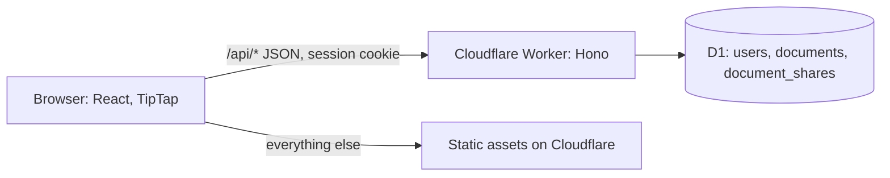

# Architecture note

## What I prioritised, in order

1. **A deployed app from minute ten.** A health route that reads the database went live before any feature. Every later step was deployed and checked on the live URL.
2. **Access rules that hold on the server.** Sharing is the part of a document tool that goes wrong quietly. One module decides who can do what, and a test asserts every cell of the access table.
3. **An editor that does not lose work.** Autosave with a visible state, and a save over someone else's newer version is refused instead of silently overwriting it.
4. **File import that keeps structure.** .docx, .md and .txt become normal editable documents with headings, lists and inline formatting intact.
5. Everything else was cut. See "Cut on purpose" below.

## Shape



- **Client** (`src/`): a React single-page app. TipTap is the editor. TanStack Query holds server state. `src/api.ts` is the only file that calls the API.
- **API** (`worker/`): a Hono app on a Cloudflare Worker. Routes parse the body with zod, call the access module, then read or write through Drizzle.
- **Database**: Cloudflare D1 (SQLite). Migrations in `migrations/` are plain SQL generated from `worker/db/schema.ts`. Local development and the tests use the D1 emulator that ships with wrangler, so nobody needs a Cloudflare account to run the project.
- **Deploy**: `npm run deploy` builds the client and uploads the client, the Worker and its config in one step. Cloudflare serves the static files itself, and only `/api/*` runs the Worker.

## Data model

| Table | Columns | Notes |
|---|---|---|
| `users` | id, email (unique), name, password_hash, created_at | Three seeded accounts |
| `documents` | id, owner_id, title, content, version, created_at, updated_at, updated_by | `content` is TipTap JSON stored as text. `version` goes up by one on every save |
| `document_shares` | document_id, user_id, role, created_at | Primary key on both ids. `role` is `viewer` or `editor` |
| `document_versions` | id, document_id, title, content, saved_by, saved_at | Earlier states of a document. At most 50 per document |

The owner is a column on the document, not a row in the shares table, so a document can never end up without an owner.

Content is stored as the editor's JSON, not HTML. It round-trips without loss, it can be validated node by node, and nothing in the app ever injects stored HTML into the page.

## Access rules

`worker/access.ts` is the only place that decides access. Every document route calls `requireAccess(db, documentId, userId, action)` before it does anything.

| Action | Owner | Editor | Viewer | No access | Signed out |
|---|---|---|---|---|---|
| Read the document | 200 | 200 | 200 | 404 | 401 |
| Edit content or rename | 200 | 200 | 403 | 404 | 401 |
| See who has access | 200 | 200 | 200 | 404 | 401 |
| See the version history, read an old version | 200 | 200 | 200 | 404 | 401 |
| Restore an old version | 200 | 200 | 403 | 404 | 401 |
| Share, change a role, remove a share | 200 | 403 | 403 | 404 | 401 |
| Delete | 204 | 403 | 403 | 404 | 401 |

A user with no access gets 404, not 403, so the API never confirms that a document id exists. The page hides controls a role cannot use, but that is only for comfort. The server refuses the request either way, and `test/worker/access.spec.ts` asserts every cell of this table against the real Worker and a real D1 database.

## Saving and conflicts

The editor saves about a second after the last change and shows Saving, Saved or an error with a retry. Each save sends the version it started from. The server does the version check and the write in one SQL statement:

```sql
UPDATE documents SET ..., version = version + 1 WHERE id = ? AND version = ?
```

If no row changes, someone else saved first. The server answers 409 with who saved and when, and the editor offers "Load their version" or "Keep mine". This is not real-time collaboration. It is the smallest thing that makes two people in one document safe: nobody's work is overwritten without them knowing.

## Version history

When a save replaces a document's state, the old state is kept as a version in three cases: a different person is saving than the one who wrote it, the newest kept version is more than ten minutes older, or the save is a restore. Keeping every autosave would bury the versions worth having under hundreds of near-copies. Restoring first keeps the state being replaced, so a restore can be undone. The rule lives in `worker/history.ts`.

This pairs with the conflict check. "Keep mine" overwrites the other person's save, and history is how they get it back.

## File import

Conversion runs in the browser, in `src/lib/import.ts`:

| Type | How |
|---|---|
| .txt | Paragraphs split on blank lines, line breaks kept |
| .md | TipTap's Markdown parser |
| .docx | mammoth converts to HTML, TipTap converts the HTML to editor JSON |

The result is posted as a normal new document. I chose the browser because the converters are the same code the editor already loads, the file itself never needs storing, and the Worker stays small and fast. The cost is that the server cannot trust what arrives, so `worker/content.ts` validates every document body: only the node and mark types the editor supports, heading levels 1 to 3, links limited to http, https and mailto, a depth limit and a 1 MB cap. Anything else is a 400. Images and tables in a .docx are dropped on import. The UI and README say which types are supported.

## Sign-in

Three seeded accounts with a one-click sign-in on the login page, because reviewers need to switch users to see sharing work. Underneath it is a real flow: passwords are hashed with PBKDF2-SHA256 through Web Crypto, and the session is a signed, httpOnly, SameSite=Lax cookie. Writes from another origin are refused.

Password hashing strength was measured on the deployed platform before choosing it, with a throwaway Worker called 25 times per setting:

| PBKDF2 iterations | CPU average | CPU max |
|---|---|---|
| 20,000 | 5 ms | 9 ms |
| 50,000 | 11 ms | 20 ms |
| 100,000 | 26 ms | 46 ms |

The app uses 100,000. The account is on the Workers Paid plan, where the CPU limit is 30 seconds per request. On the free plan the limit is 10 ms and the right setting would be 20,000. A production system with real passwords would use a managed identity provider instead.

## Cut on purpose

- **Real-time co-editing and presence.** The honest version of this needs a CRDT (Yjs) and a stateful server (a Durable Object per document). That is most of a day done properly. Version checks give safe turn-taking for a fraction of the cost.
- **Sign-up, password reset, email invites.** Seeded users show the sharing model without an email service.
- **Images, tables, PDF export, folders, search, trash.** None of them changes how the core is built.
- **Suggestion mode and comments.** Version history covers "what changed and who did it" at a coarser grain for much less work.

## With another 2 to 4 hours

1. Real-time editing with Yjs in a Durable Object, with presence.
2. A diff view between two versions, and named versions.
3. Link sharing ("anyone with the link can view") and email invites for people without an account.
4. Images in documents, stored in R2, and tables.
5. Rate limiting on login, and a Playwright run against the deployed URL in CI.
