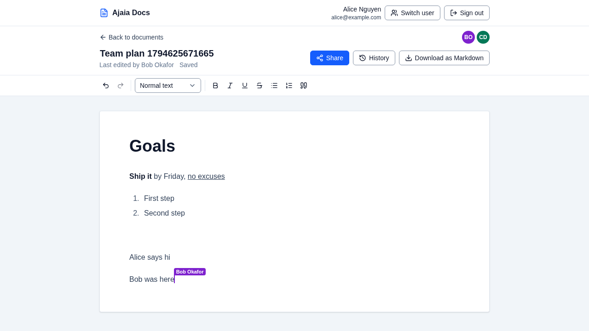

# Ajaia Docs

A small collaborative document editor: write rich text together in real time, import files, and share documents with view or edit access.

**Live app:** https://ajaia-docs.8thlayersolutions.workers.dev

## Test accounts

The login page has a one-click button for each account. The password for all three is `ajaia-demo`.

| Account | Email | In the seeded data |
|---|---|---|
| Alice Nguyen | alice@example.com | Owns "Welcome to Ajaia Docs". Can edit Bob's "Launch checklist" |
| Bob Okafor | bob@example.com | Owns "Launch checklist". Can edit Alice's welcome document |
| Carol Diaz | carol@example.com | Can only view Alice's welcome document |

The header has a "Switch user" menu, so you can move between accounts without going back to the login page. To see live editing, open the same document as two people: one in a normal window and one in a private window.



| Share dialog | Version history |
|---|---|
|  |  |

More screens are in [docs/screenshots](docs/screenshots): login, document list, the editor, the read-only view, and an imported .docx.

## What works

- **Documents:** create, rename, edit, delete, reopen. Changes save on their own about a second after you stop typing, with a Saving and Saved indicator.
- **Formatting:** bold, italic, underline, strikethrough, headings 1 to 3, bulleted and numbered lists, quotes, links, undo and redo.
- **Real-time editing:** several people can edit one document at once. Each sees the others' text arrive as it is typed, their cursors with a name label, and who else is in the document. Two people typing in the same paragraph merge cleanly.
- **File import:** `.txt`, `.md` and `.docx`, up to 2 MB, each becomes a new editable document. Headings, lists, bold, italic and underline are kept. Images and tables in a .docx are dropped.
- **Sharing:** the owner shares with another user as **Can edit** or **Can view**, changes a role, or removes access. The document list separates "Owned by me" from "Shared with me".
- **Roles are enforced on the server, including on the live connection.** A viewer sees edits arrive but anything their browser sends is dropped. A user without access cannot tell the document exists. A role change takes effect at once, even for someone who has the document open. See the access table in [ARCHITECTURE.md](ARCHITECTURE.md).
- **Version history:** earlier versions of a document are kept, can be read, and can be restored. A restore reaches everyone who has the document open, and can itself be undone.
- **Export:** download any document as Markdown.

## What is not built

- Sign-up, password reset and email invites. You can only share with the three seeded accounts.
- Comments, images, tables, PDF export, folders and search. Tables in an imported Markdown file are dropped.
- Names on cursors come from each person's browser and are not checked by the server. Edits are.

[ARCHITECTURE.md](ARCHITECTURE.md) explains each cut and what I would build next with another 2 to 4 hours.

## Run it locally

You need Node 22 or newer. No Cloudflare account is needed: the database and the live rooms run in the local emulator that ships with wrangler.

```bash
npm install
cp .dev.vars.example .dev.vars   # the session secret for local use
npm run db:local                 # creates the local database with the three accounts
npm run dev                      # http://127.0.0.1:3410
```

## Tests

```bash
npm test            # 99 tests, about 10 seconds
npm run test:e2e    # 3 browser tests, needs `npm run dev` running in another terminal
```

- `test/worker`: API and live-editing tests that run inside the Workers runtime, against a real D1 database built from the production migrations and real sockets into the real Durable Object. They assert every cell of the access table (5 kinds of user, 9 actions), that a viewer's edits over the socket are dropped, that a forged role is ignored, that role changes close open sockets, that two people typing at once end up with the same text, that formatting survives a live edit and save, that a room keeps its state across a restart, version history, and content validation.
- `test/lib`: file import and export on real fixture files, including a .docx, plus the rejection cases (wrong type, empty, too large, damaged). Import results are checked against the server's own validation rules.
- `test/e2e`: three Playwright tests in real browsers. Set `E2E_BASE_URL` to run them against any deployed copy. I run them against the live URL after each deploy.
  - The whole flow with three people in three browsers on one document: write and format, reload, share as editor and as viewer, edits and cursors arriving live, the viewer unable to type, a restore reaching the others without a reload, .docx import.
  - The owner lowers someone's role, then removes them, while that person has the document open.
  - Two tabs in one browser: when one switches user, the other follows.

There are no component tests with a mocked API. I removed the ones I had: they only asserted on mocks or repeated what the browser tests prove against the real server.

Every push to `main` runs the build, `npm test` and the browser test against the production build (`.github/workflows/ci.yml`, on a self-hosted runner).

## Deploy

```bash
npx wrangler login
npx wrangler d1 create ajaia-docs      # put the returned id in wrangler.jsonc
npm run db:remote                      # applies migrations, including the seed
openssl rand -hex 32 | npx wrangler secret put SESSION_SECRET
npm run deploy
```

`wrangler.jsonc` also has a `staging` environment with its own database and live rooms. I used it to prove real-time editing on Cloudflare before it replaced the live site: `CLOUDFLARE_ENV=staging npm run deploy`.

## Project layout

```
src/                 React client
  api.ts             the only file that calls the API, with all shared types
  pages/             login, document list, editor
  components/        header, toolbar, share dialog, version history, presence
  hooks/useCollab.ts the live connection to a document's room
  lib/               editor extensions, file import, Markdown export
  index.css          theme for the ui-sdk components, document and cursor styles
worker/              Cloudflare Worker (Hono)
  access.ts          who can do what to a document. Every route calls it
  room.ts            the live room for one document (Durable Object, Yjs)
  content.ts         validation of document content
  session.ts         signed cookie sessions
  history.ts         when an earlier version of a document is kept
  routes/            auth, documents, shares, version history, the live socket
  db/schema.ts       tables (Drizzle)
migrations/          SQL migrations and the seed data
scripts/             seed generator, and a script that resets the demo data
test/                API and live-editing, import, and browser tests
```

## Other documents

- [ARCHITECTURE.md](ARCHITECTURE.md): what I prioritised, how it is built, and the tradeoffs.
- [AI_WORKFLOW.md](AI_WORKFLOW.md): which AI tools I used, what I changed or rejected, and how I verified the result.
- [SUBMISSION.md](SUBMISSION.md): what is in this submission.
