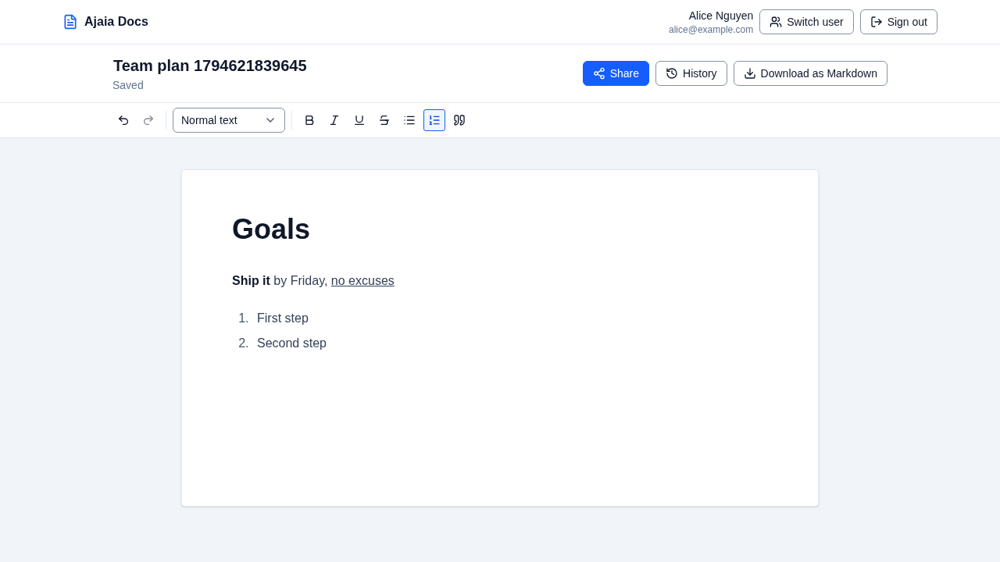
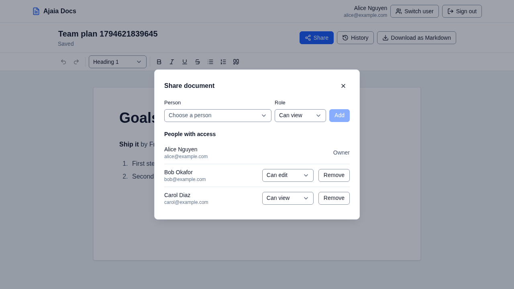
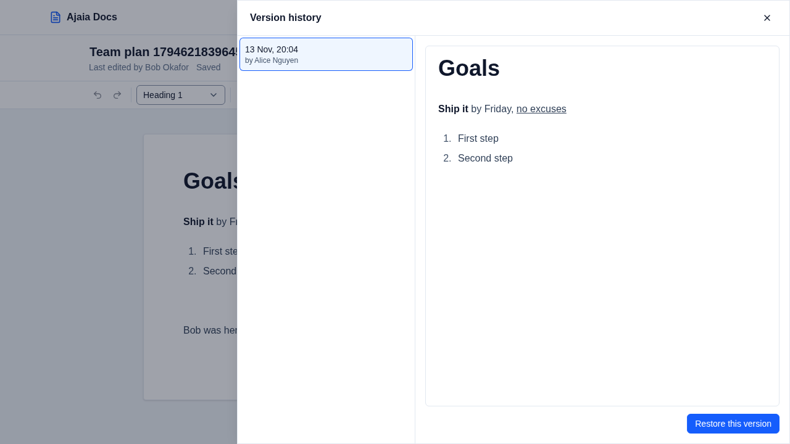

# Ajaia Docs

A small collaborative document editor: write rich text, import files, and share documents with view or edit access.

**Live app:** https://ajaia-docs.8thlayersolutions.workers.dev

## Test accounts

The login page has a one-click button for each account. The password for all three is `ajaia-demo`.

| Account | Email | In the seeded data |
|---|---|---|
| Alice Nguyen | alice@example.com | Owns "Welcome to Ajaia Docs". Can edit Bob's "Launch checklist" |
| Bob Okafor | bob@example.com | Owns "Launch checklist". Can edit Alice's welcome document |
| Carol Diaz | carol@example.com | Can only view Alice's welcome document |

The header has a "Switch user" menu, so you can move between accounts without going back to the login page.



| Share dialog | Version history |
|---|---|
|  |  |

More screens are in [docs/screenshots](docs/screenshots): login, document list, the read-only view, a save conflict, and an imported .docx.

## What works

- **Documents:** create, rename, edit, delete, reopen. Changes save on their own about a second after you stop typing, with a Saving and Saved indicator.
- **Formatting:** bold, italic, underline, strikethrough, headings 1 to 3, bulleted and numbered lists, quotes, links, undo and redo.
- **File import:** `.txt`, `.md` and `.docx`, up to 2 MB, each becomes a new editable document. Headings, lists, bold, italic and underline are kept. Images and tables in a .docx are dropped.
- **Sharing:** the owner shares with another user as **Can edit** or **Can view**, changes a role, or removes access. The document list separates "Owned by me" from "Shared with me".
- **Roles are enforced on the server.** A viewer cannot save, a user without access cannot tell the document exists. See the access table in [ARCHITECTURE.md](ARCHITECTURE.md).
- **Conflict safety:** if two people edit the same document, the second save is refused and that person chooses "Load their version" or "Keep mine". Nothing is overwritten silently.
- **Version history:** earlier versions of a document are kept, can be read, and can be restored. A restore can itself be undone.
- **Export:** download any document as Markdown.

## What is not built

- Real-time co-editing and presence. Editing is turn-based with the conflict check above.
- Sign-up, password reset and email invites. You can only share with the three seeded accounts.
- Comments, images, tables, PDF export, folders and search. Tables in an imported Markdown file are dropped.

[ARCHITECTURE.md](ARCHITECTURE.md) explains each cut and what I would build next with another 2 to 4 hours.

## Run it locally

You need Node 22 or newer. No Cloudflare account is needed: the database runs in the local emulator that ships with wrangler.

```bash
npm install
cp .dev.vars.example .dev.vars   # the session secret for local use
npm run db:local                 # creates the local database with the three accounts
npm run dev                      # http://127.0.0.1:3410
```

## Tests

```bash
npm test            # 101 tests, about 10 seconds
npm run test:e2e    # the browser test, needs `npm run dev` running in another terminal
```

- `test/worker`: API tests that run inside the Workers runtime against a real D1 database built from the production migrations. They assert every cell of the access table (5 kinds of user, 10 actions), that a refused edit changes nothing, that role changes take effect at once, save conflicts, version history, and content validation.
- `test/lib`: file import and export on real fixture files, including a .docx, plus the rejection cases (wrong type, empty, too large, damaged). Import results are checked against the server's own validation rules.
- `test/ui`: the toolbar and the share dialog as components.
- `test/e2e`: one Playwright test of the whole flow in a real browser: write and format, reload, share as editor and as viewer, each role's view, version history and restore, .docx import. Set `E2E_BASE_URL` to run it against any deployed copy. I run it against the live URL after each deploy.

Every push to `main` runs the build, `npm test` and the browser test against the production build (`.github/workflows/ci.yml`, on a self-hosted runner).

## Deploy

```bash
npx wrangler login
npx wrangler d1 create ajaia-docs      # put the returned id in wrangler.jsonc
npm run db:remote                      # applies migrations, including the seed
openssl rand -hex 32 | npx wrangler secret put SESSION_SECRET
npm run deploy
```

## Project layout

```
src/                 React client
  api.ts             the only file that calls the API, with all shared types
  pages/             login, document list, editor
  components/        header, toolbar, share dialog, version history
  hooks/             autosave
  lib/               editor extensions, file import, Markdown export
  index.css          theme for the ui-sdk components, and the document styles
worker/              Cloudflare Worker (Hono)
  access.ts          who can do what to a document. Every route calls it
  content.ts         validation of document content
  session.ts         signed cookie sessions
  history.ts         when an earlier version of a document is kept
  routes/            auth, documents, shares and version history
  db/schema.ts       tables (Drizzle)
migrations/          SQL migrations and the seed data
scripts/             seed generator, and a script that resets the demo data
test/                API, import, component and browser tests
```

## Other documents

- [ARCHITECTURE.md](ARCHITECTURE.md): what I prioritised, how it is built, and the tradeoffs.
- [AI_WORKFLOW.md](AI_WORKFLOW.md): which AI tools I used, what I changed or rejected, and how I verified the result.
- [SUBMISSION.md](SUBMISSION.md): what is in this submission.
